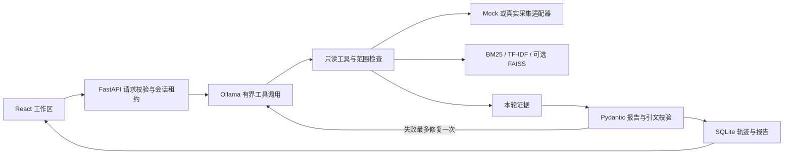

# SenseSkin AI

CS2 饰品研究工作区：浏览行情、比较平台、计算租买成本，再通过能调用工具的本地 Agent 形成可追溯报告。

**推荐运行方式：Mock 业务 API + 真实免费本地模型。** 行情、租金和示例事件均显式标注，不伪装实时市场数据。项目定位为可验收的单用户本地产品，生产部署缺口见 [工程证据与边界](docs/engineering-evidence.md)。

## 快速启动

要求 Python 3.12+、Node 22.12+，以及 [Ollama](https://ollama.com/download)。

```bash
make setup
ollama serve                  # 单独终端；服务已运行时无需再启动
ollama pull qwen3:4b           # 约 2.5 GB，本地推理，无按量 API 费用
make dev
```

打开 **http://localhost:5173**。启动器默认使用 `backend/senseskin-demo.db`，自动初始化 31 件饰品和确定性模拟历史，不覆盖原有 `skinsense.db`。首次启动后进入“连接与数据”，确认模型服务与模型文件实际可用。

如果当前工作区已有 `.runtime/ollama/ollama`，`make dev` 会复用该独立运行时，监听本机 `11435`；模型位于 `.runtime/models`。其他情况默认连接 `127.0.0.1:11434`。可用 `OLLAMA_URL=http://127.0.0.1:11435 make dev` 指定已有服务。

断开模型后仍可浏览、计算和检索。若希望显式使用无模型证据模式，可手动启动后端并设置 `AI_PROVIDER=anthropic`、清空模型密钥。已选择 Ollama 但服务故障时，会保留证据并报告失败，不把它伪装成成功的 AI 回答。

## 用户流程

- **饰品市场**：搜索、分类、外观、来源和价格排序保留在 URL，紧凑事件摘要，真实/演示/未核验/过期标签。
- **详情 / 平台对比 / 租买**：行情历史、七维规则评分、证据链、平台价差与费用边界；缺失押金不按零处理。
- **AI 研究**：至多三件饰品，四类任务，模型选工具、受限执行、结构化报告、来源引用、一次修复、继续追问、停止和失败恢复。
- **研究库**：搜索最近 50 条研究、重命名、归档和恢复；详情内导出 Markdown 报告。
- **自选监控**：浏览器持久化收藏、目标价与备注。仅在页面打开时检查；演示价格触发时注明“演示检查”，过期/未知来源不触发。
- **事件中心**：摘要、来源、发布时间、同步、原文链接；Mock 事件不伪造官方链接。
- **连接与数据**：实际模型健康、数据库运行统计、知识原文检索与可现场执行的 24 题评估。

## Agent 与数据架构



本地 Agent 使用 Ollama 原生 API 的 JSON Schema 输出选择工具（不依赖模型的原生 function-call 参数输出），最多四轮工具选择，工具参数为受限 schema，用户范围不可由模型扩大。模型报告通过校验后才发布，SSE 在此之前展示真实进度。数字与引文匹配是确定性校验，**不等于语义正确性或投资收益验证**。

保留 Anthropic / OpenAI-compatible 的旧流式综合适配器，但它们不具备新增 Ollama 路径的结构化校验能力。新工具 Agent 推荐使用 `AI_PROVIDER=ollama`。

## 配置

后端配置模板见 [backend/.env.example](backend/.env.example)，模型密钥只保存在后端。`make dev` 会显式覆盖数据模式、数据库和 Provider 为推荐演示环境；自定义服务配置请直接运行 uvicorn。

| 参数 | 用途 |
| --- | --- |
| `DATA_MODE=mock` | 行情和事件刷新不请求外部来源；保留快照原始时间 |
| `DATA_MODE=live` | 启用原有 Steam / BUFF 适配器；成功与否按每次来源响应判断 |
| `AI_PROVIDER=ollama` | 免费本地 Agent |
| `OLLAMA_URL` / `OLLAMA_MODEL` | 服务地址 / 模型名称，默认 qwen3:4b |
| `RAG_ENABLE_FAISS=false` | 默认轻量检索，无 embedding 下载；开启语义通道需安装 requirements.txt 并下载真实模型 |
| `ENABLE_MARKET_SYNC=false` | 真实后台采集默认关闭，Mock 模式不会开启 |

业务 API 使用同一套响应契约；Mock 通过种子数据和 provider 分支实现，前端没有隐藏随机数据兜底。接口文档：http://127.0.0.1:8000/docs 。

## 验证

```bash
make check       # Python 测试 + TypeScript + Node 单测 + Vitest 交互测试 + Vite 构建
make evaluate    # 24 题双语检索回归门禁
make smoke       # 已启动 make dev 后：真实本地模型的行情/知识/租买验收
```

`make check` 固定 BLAS/OpenMP 为一个线程，避免部分 macOS 原生 FAISS 环境初始化阻塞。真实 embedding 烟测需显式开启，默认跳过；单测中的固定向量仅用于验证检索逻辑。

GitHub Actions 同时验证后端、前端和检索基线。运行时 token、耗时与成功/失败计数来自实际返回与持久化记录，不填充营销数字。

最新本地结果、真实模型用例和桌面/移动截图见 [2026-11-27 验收记录](docs/validation-2026-11-27.md)。
量化卡片、平台价差、租买成本与研究统计的计算口径及截图见 [量化界面验收](docs/quantitative-ui.md)。

## 容器定义

```bash
docker compose up --build
```

Compose 定义内部 Ollama + 自动模型下载 + FastAPI + Nginx 前端，网页仅绑定本机 `8080`。模型与数据库使用命名卷，SSE 代理关闭 buffering。首次下载需要网络。此机器没有 Docker，因此容器启动仍待验收；Mac 原生 Ollama 使用 Metal，容器运行可能更慢。

## 设计参考与能力边界

参考 [88dog](https://www.88dog.com/) 的分类浏览、紧凑公告与快捷入口，以及 [CSFloat](https://csfloat.com/) 的商品信息组织；沿用现有 React/Tailwind 体系，不复制开箱、充值或交易流程。交互检查采用 [Vercel Web Design Guidelines](https://github.com/vercel-labs/agent-skills/tree/main/skills/web-design-guidelines)。

本项目尚无账户隔离、跨设备收藏、后台通知、完整真实租赁 API、云端 AgentCore/Strands 部署或生产监控。当前服务只适合受信任的本地单用户环境。完整的简历对应代码证据和未完成列表见 [工程证据与边界](docs/engineering-evidence.md)。
